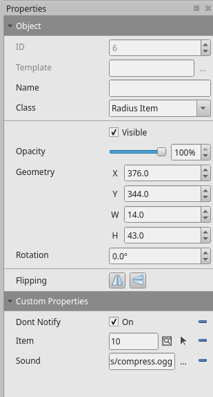

# ONB_ezcollection

Simple custom ezlibs script for making Tiled objects into collectibles.

Copy repo for demo map or download release for zip of just the scripts

(ezlibs and server binary not included)


## Ezlibs

 - [ezlibs](https://github.com/Keristero/ezlibs-scripts)

## Tiled Custom Properties

#### Tiled Class: Radius Item

| Properties | Type     | Description                |
| :-------- | :------- | :------------------------- |
|`Item`|`object`|Item object to give player,  see ezlibs docs|
|`Sound`|`string`|File path to sound that will play on pickup*|
|`Dont Notify`|`bool`|Don't produce a text box for item|
| `Event` | `string` | Name of the function to call from collection_events |
|`Once`|`bool`|Remove permanently after pickup|
|`Radius`|`float`|Change interaction radius|

*You can also set properties `Sound 1``Sound 2``Sound 3``Sound 4` to have a random sound play


## Ezlibs Config
`collection.lua`
Add to /scripts/ezlibs-custom

`collection_events`
Add to /scripts/events

Add to /scripts/ezlibs-custom/custom.lua
```
local collection = require('scripts/ezlibs-custom/collection')
``` 


## Tiled Example



